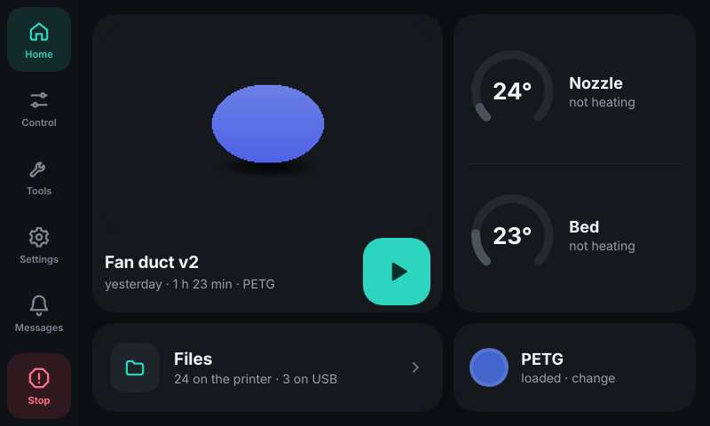
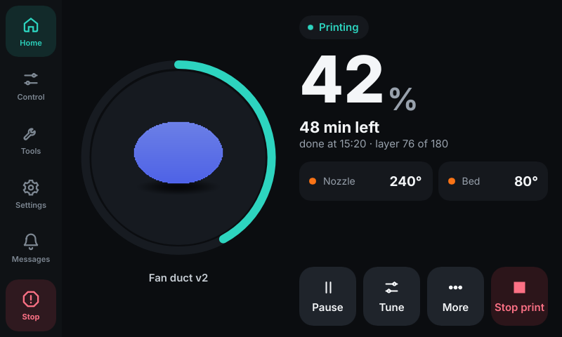
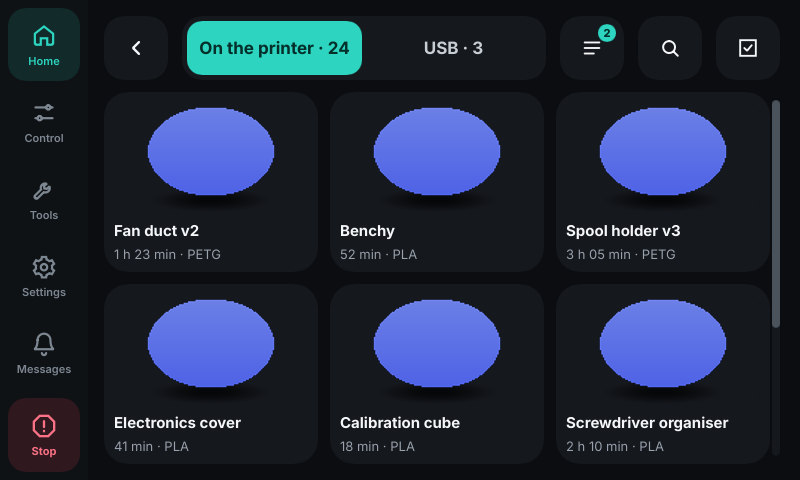
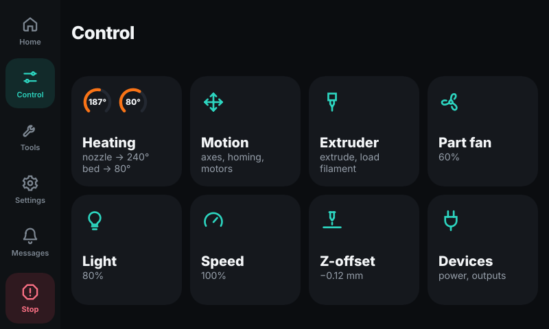

# Rivet

A touch screen for Klipper printers, made for the **Flashforge Adventurer 5M and 5M Pro**.
It replaces the screen that comes with [Klipper Mod](https://github.com/xblax/flashforge_ad5m_klipper_mod)
(GuppyScreen) and talks to Klipper through Moonraker, like Fluidd and Mainsail do.

[Русская версия](README.ru.md)

| Home | Printing | Files | Control |
|---|---|---|---|
|  |  |  |  |

> **Alpha.** Rivet prints, tunes and calibrates on the author's AD5M Pro every day, but it has
> not been on many printers yet. Keep Fluidd or Mainsail at hand, and
> [report what goes wrong](https://github.com/lDOCI/rivet/issues).

## Which printers

| Printer | Firmware | State |
|---|---|---|
| Adventurer 5M / 5M Pro | Klipper Mod | **supported**: install from a USB stick or over ssh |
| Adventurer 5M / 5M Pro | Z-Mod | runs, once Z-Mod lists Rivet as one of its screens (as it does HelixScreen) |
| Adventurer 5M / 5M Pro | Forge-X, stock firmware | not supported |
| Adventurer 5X | any | planned: a different processor (MIPS) and the 4-colour IFS |
| Other Klipper printers | — | later. Nothing in Rivet is tied to the AD5M except the installer; the screen size is fixed at 800×480 for now |

## What it does

Everything a printer screen is expected to do, and what GuppyScreen, KlipperScreen and
HelixScreen do between them:

- **Printing**: progress, time left, layer, speed, flow, Z-offset, pressure advance, fans and
  temperatures during the print; pause, resume, stop; skip an object on a map of the bed;
  pause at a chosen layer; end-of-print summary; filament runout screen.
- **Files**: grid with previews, on the printer and on a USB stick; search, sort, rename, move,
  copy from USB, delete several at once; print queue; checks before printing (nozzle size,
  model height against the Z travel).
- **Control**: heaters with presets and a temperature graph, moving and homing, extruding,
  filament load and unload wizard, fans, light, speed and flow, Z-offset, power devices,
  firmware retraction, Spoolman spools.
- **Calibration**: bed mesh with profiles, bed screws, probe accuracy, input shaper with the
  graphs drawn on the printer, belt comparison, PID, pressure advance, load cell tare,
  TMC drivers, motion limits.
- **Tools**: macros with their parameters, console with an on-screen keyboard, print history,
  sensors, maintenance reminders, filament drying on the bed, the camera list (no live
  video on the screen yet).
- **Settings**: Wi-Fi (scan and join), brightness, sleep, lock with a PIN, sound, language
  and time, safety confirmations, themes, touch calibration, updates, system.

A screen or a row shows only when the printer has what it needs: no accelerometer, no
input shaper screen; no Spoolman, no spools.

## What is different

- **Small.** One program of 14 MB with nothing to install next to it. On the AD5M Pro it
  uses about 9–12 MB of memory while idle and under 1 % of the processor, so it leaves the
  printer's 128 MB to Klipper and Moonraker.
- **Made for a finger on this panel.** The AD5M has a resistive touch panel. A tap that lands
  just beside a button goes to the button; a tap stays on the button it started on even if
  the finger rolls; nine-point touch calibration on the screen, which ignores one bad tap;
  a touch test screen to see where your taps land.
- **Updates that cannot leave you without a screen.** Updates come from GitHub through
  Moonraker, from the screen or from Fluidd/Mainsail. A new version that does not start, or
  does not match its checksum, is replaced by the last version that worked, by itself.
- **Installs like Klipper Mod itself**: unpack onto a USB stick, switch the printer on.
- Things the other screens do not have: **load cell tare** (AD5M), **switch off after the
  print** and **restart into the stock firmware** (Klipper Mod), **pause at a layer** even when
  the slicer did not write layer numbers (Rivet uses the height), **any accent and background
  colour**, light themes included.
- English and Russian.

## Install

On Klipper Mod. Details, the ssh way and what exactly changes on the printer:
[docs/install.md](docs/install.md).

1. Download `rivet-<version>-usb.zip` from the [latest release](https://github.com/lDOCI/rivet/releases/latest).
2. Unpack it onto a FAT32 USB stick, so that `flashforge_init.sh` and the `rivet` folder are at the top.
3. With the printer off, insert the stick and switch the printer on.
4. The screen says *Installing Rivet…*, then *Rivet is installed*. Remove the stick: the printer
   restarts with Rivet.

**Update**: Settings › Updates › *Update the screen*, or the update list in Fluidd/Mainsail.
**Remove**: the same with `rivet-<version>-usb-remove.zip`; GuppyScreen comes back.

## Documents

| | |
|---|---|
| [docs/install.md](docs/install.md) | install, update, remove, logs, when something goes wrong |
| [docs/integration.md](docs/integration.md) | for firmware authors: running Rivet as one of your screens (Z-Mod, others) |
| [docs/development.md](docs/development.md) | building, running on a computer, tests, how a release is made |
| [CHANGELOG.md](CHANGELOG.md) | what changed in each release |
| [ROADMAP.md](ROADMAP.md) | what comes next |

## License

[GPL-3.0-or-later](LICENSE). Built with [Slint](https://slint.dev) (GPLv3) and Rust.
