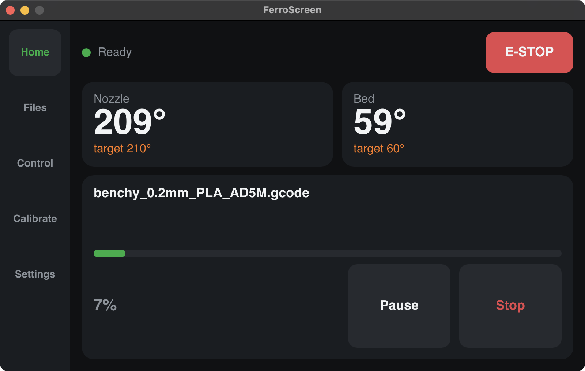

# Rivet

Lightweight touch UI for Klipper/Moonraker, written in Rust + [Slint](https://slint.dev).
First target: Flashforge Adventurer 5M / 5M Pro running [Klipper Mod](https://github.com/xblax/flashforge_ad5m_klipper_mod)
(Allwinner T113-S3, 128 MB RAM, 4.3" 800×480).

Status: early prototype (milestone M0). Roadmap: [ROADMAP.md](ROADMAP.md). Architecture: [docs/ARCHITECTURE.md](docs/ARCHITECTURE.md).



## Develop on a desktop

Requires Rust (stable, via [rustup](https://rustup.rs)).

Without a printer — run the fake Moonraker in one terminal:

```bash
cargo run -p mock-moonraker
```

Type `print`, `shutdown` or `ready` into it to drive scenarios. In a second terminal:

```bash
cargo run -p rivet
```

Against a real printer over the network (nothing is installed on it):

```bash
cargo run -p rivet -- --moonraker ws://PRINTER_IP:7125/websocket
```

Logs: `RUST_LOG=debug cargo run -p rivet`.

Tests: `cargo test --workspace`.

## Layout

| Path | What |
|---|---|
| `crates/moonraker` | async JSON-RPC client with reconnect |
| `crates/model` | printer state, status delta merging |
| `crates/app` | `rivet` binary: Slint UI + network thread |
| `crates/mock-moonraker` | fake Moonraker for development |
| `ui/` | `.slint` theme, components, screens |

## License

GPL-3.0-or-later.
