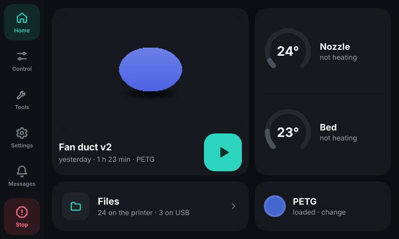
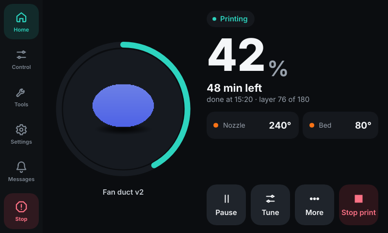
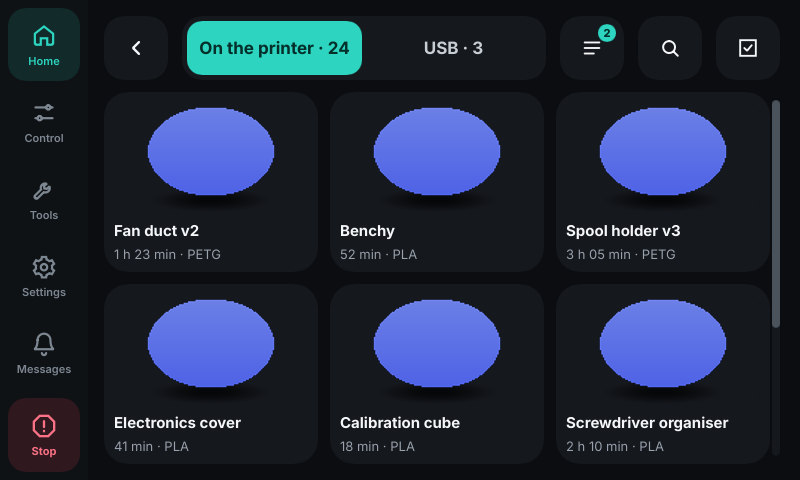
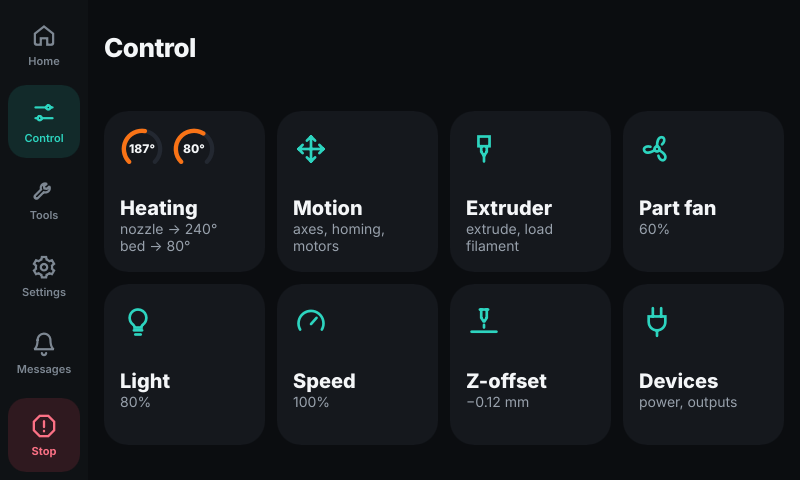

# Rivet

Сенсорный экран для принтеров на Klipper, сделанный для **Flashforge Adventurer 5M и 5M Pro**.
Заменяет экран, который идёт с [Klipper Mod](https://github.com/xblax/flashforge_ad5m_klipper_mod)
(GuppyScreen), и работает с Klipper через Moonraker, как Fluidd и Mainsail.

[English version](README.md)

| Главная | Печать | Файлы | Управление |
|---|---|---|---|
|  |  |  |  |

> **Альфа-версия.** На AD5M Pro автора Rivet каждый день печатает, подстраивает и калибрует,
> но на многих принтерах он ещё не был. Держите под рукой Fluidd или Mainsail и
> [пишите, что пошло не так](https://github.com/lDOCI/rivet/issues).

## Какие принтеры

| Принтер | Прошивка | Состояние |
|---|---|---|
| Adventurer 5M / 5M Pro | Klipper Mod | **поддерживается**: установка с флешки или по ssh |
| Adventurer 5M / 5M Pro | Z-Mod | работает, когда Z-Mod добавит Rivet в список своих экранов (как HelixScreen) |
| Adventurer 5M / 5M Pro | Forge-X, стоковая прошивка | не поддерживается |
| Adventurer 5X | любая | в планах: другой процессор (MIPS) и система IFS на 4 цвета |
| Другие принтеры на Klipper | — | позже. К AD5M в Rivet привязан только установщик; размер экрана пока жёстко 800×480 |

## Что умеет

Всё, что ожидается от экрана принтера, и всё, что вместе умеют GuppyScreen, KlipperScreen и
HelixScreen:

- **Печать**: прогресс, оставшееся время, слой, скорость, поток, Z-offset, pressure advance,
  вентиляторы и температуры во время печати; пауза, продолжение, остановка; пропуск объекта
  на карте стола; пауза на выбранном слое; итог печати; экран «закончился филамент».
- **Файлы**: сетка с превью, на принтере и на флешке; поиск, сортировка, переименование,
  перемещение, копирование с флешки, удаление нескольких сразу; очередь печати; проверки
  перед печатью (диаметр сопла, высота модели против хода по Z).
- **Управление**: нагрев с пресетами и графиком температур, движение и парковка, выдавливание,
  мастер загрузки и выгрузки филамента, вентиляторы, свет, скорость и поток, Z-offset,
  устройства питания, ретракт прошивки, катушки Spoolman.
- **Калибровки**: карта стола с профилями, винты стола, точность датчика, input shaper с
  графиками прямо на принтере, сравнение ремней, PID, pressure advance, обнуление тензодатчика,
  драйверы TMC, лимиты движения.
- **Инструменты**: макросы с параметрами, консоль с экранной клавиатурой, история печати,
  датчики, напоминания об обслуживании, сушка филамента на столе, список камер (видео на
  экране пока нет).
- **Настройки**: Wi-Fi (поиск и подключение), яркость, сон, блокировка с PIN, звук, язык и
  время, подтверждения опасных действий, темы, калибровка тача, обновления, система.

Экран или строка появляются, только если у принтера есть нужное: нет акселерометра — нет
экрана input shaper, нет Spoolman — нет катушек.

## Чем отличается

- **Лёгкий.** Одна программа на 14 МБ, ставить рядом ничего не нужно. На AD5M Pro в простое
  занимает около 9–12 МБ памяти и меньше 1 % процессора, остальные 128 МБ остаются Klipper и
  Moonraker.
- **Сделан под палец на этой панели.** У AD5M резистивный тач. Касание чуть мимо кнопки
  попадает в кнопку; нажатие остаётся на той кнопке, где началось, даже если палец съехал;
  калибровка тача по девяти точкам прямо на экране, одно неудачное касание она отбрасывает;
  экран проверки касаний, чтобы видеть, куда вы попадаете.
- **Обновления, после которых экран не пропадёт.** Новые версии приходят с GitHub через
  Moonraker — с самого экрана или из Fluidd/Mainsail. Если новая версия не запустилась или
  не совпала контрольная сумма, сама возвращается последняя рабочая.
- **Ставится как сам Klipper Mod**: распаковать на флешку, включить принтер.
- Чего нет у других экранов: **обнуление тензодатчика** (AD5M), **выключение после печати** и
  **перезагрузка в стоковую прошивку** (Klipper Mod), **пауза на слое**, даже если слайсер не
  записал номера слоёв (Rivet ориентируется по высоте), **любой цвет акцента и фона**, в том
  числе светлые темы.
- Русский и английский.

## Установка

На Klipper Mod. Подробно, способ через ssh и что именно меняется на принтере —
[docs/install.ru.md](docs/install.ru.md).

1. Скачайте `rivet-<версия>-usb.zip` из [последнего релиза](https://github.com/lDOCI/rivet/releases/latest).
2. Распакуйте на флешку FAT32 так, чтобы `flashforge_init.sh` и папка `rivet` лежали в корне.
3. На выключенном принтере вставьте флешку и включите его.
4. На экране появится «Устанавливаю Rivet…», потом «Rivet установлен». Выньте флешку —
   принтер перезагрузится уже с Rivet.

**Обновить**: Настройки › Обновления › «Обновить экран» или список обновлений в Fluidd/Mainsail.
**Удалить**: так же, архивом `rivet-<версия>-usb-remove.zip`; вернётся GuppyScreen.

## Документы

| | |
|---|---|
| [docs/install.ru.md](docs/install.ru.md) | установка, обновление, удаление, логи, если что-то пошло не так |
| [docs/integration.ru.md](docs/integration.ru.md) | для авторов прошивок: как сделать Rivet одним из своих экранов (Z-Mod и другие) |
| [docs/development.ru.md](docs/development.ru.md) | сборка, запуск на компьютере, тесты, как делается релиз |
| [CHANGELOG.md](CHANGELOG.md) | что изменилось в каждом релизе |
| [ROADMAP.md](ROADMAP.md) | что дальше |

## Лицензия

[GPL-3.0-or-later](LICENSE). Сделано на [Slint](https://slint.dev) (GPLv3) и Rust.
